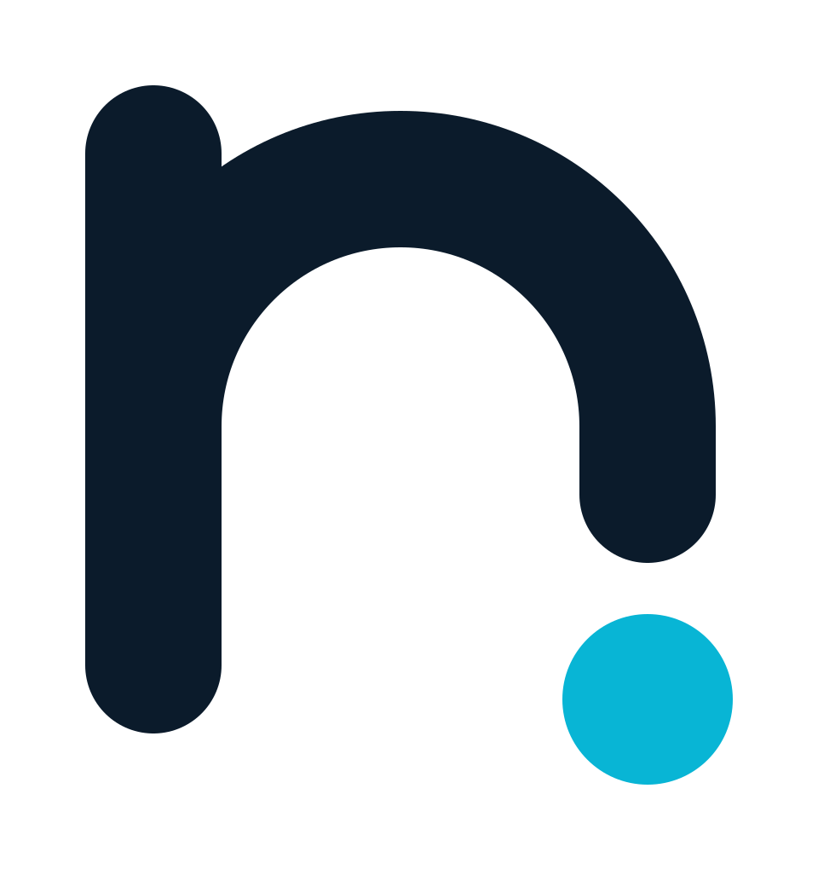

<!-- HEADER -->

## 👋 About me

I'm a **systems information graduate** from Brazil who turns ideas into production SaaS: from the database and queues
to the AI agent that answers the customer on WhatsApp.

> 🇧🇷 *Desenvolvedor full-stack, criando produtos SaaS do banco de dados à IA que atende o cliente.*

<table>
  <tr>
    <td width="50%" valign="top">
      <a href="https://app.notfy.ai">
        <picture>
          <source media="(prefers-color-scheme: dark)" srcset="profile-assets/notfy-logo-dark-mode.svg">
          
        </picture>
      </a>
        
      Multi-tenant CRM with <b>AI agents</b>, omnichannel messaging (WhatsApp and Instagram), ads management and
      financial/fiscal automation.
        
      
      
      
      
    </td>
    <td width="50%" valign="top">
      <picture>
        <source media="(prefers-color-scheme: dark)" srcset="profile-assets/pedfy-logo-dark-mode.svg">
        
      </picture>
        
      Ordering, POS, kitchen display and delivery for restaurants, with finance and fiscal modules built in.
         
      
      
      
    </td>
  </tr>
</table>

- 🧠 Exploring **AI agents with tool calling**, and how to make them reliable in real businesses
- ⚙️ Obsessed with the parts that keep products alive: queues, observability, tests and deploys
- 🌱 Always learning: currently deep into **Laravel 13**, **Filament 5** and **AI-native** product design

## 🛠️ Tech stack

 

 

| Area | What I work with |
| --- | --- |
| **Backend** | [PHP](https://www.php.net), [Laravel](https://laravel.com), [Filament](https://filamentphp.com), [Livewire](https://livewire.laravel.com), [Horizon](https://laravel.com/docs/horizon), [Octane](https://laravel.com/docs/octane) |
| **Data** | [PostgreSQL](https://www.postgresql.org), [Redis](https://redis.io), queues and scheduled jobs |
| **Frontend** | [TypeScript](https://www.typescriptlang.org), [React](https://react.dev), [Next.js](https://nextjs.org), [Tailwind CSS](https://tailwindcss.com) |
| **AI** | Agents with tool calling, multimodal input (audio, image, PDF), [Claude](https://www.anthropic.com) and [OpenAI](https://openai.com) APIs |
| **Integrations** | [WhatsApp Cloud API](https://developers.facebook.com/docs/whatsapp/cloud-api), [Instagram](https://developers.facebook.com/docs/instagram-platform), [Meta Ads](https://www.facebook.com/business/ads), [Google Ads](https://ads.google.com), [Asaas](https://www.asaas.com) |
| **Quality** | [Pest](https://pestphp.com), [PHPStan](https://phpstan.org), [Laravel Pint](https://laravel.com/docs/pint), [GitHub Actions](https://github.com/features/actions) |

## 📊 GitHub in numbers

<!--
  Cobrinha animada (opcional): exige a GitHub Action "Platane/snk" gerando a branch `output` neste repositório.
  Depois de configurar, descomente a linha abaixo.

  

-->

## 🤝 Let's connect

⭐ If something here helped you, a star on a repo makes my day.

<!-- FOOTER -->

